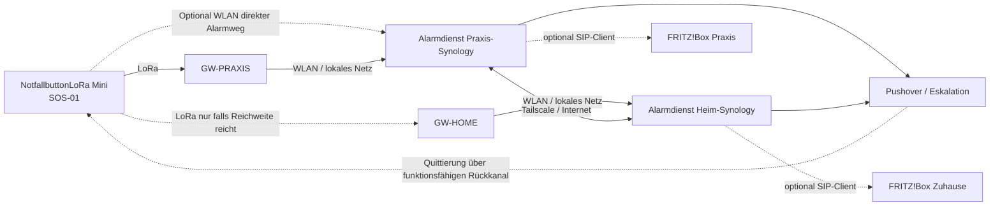

# NotfallbuttonLoRa — Projektauftrag für Coding-Agenten

> Projektname: **NotfallbuttonLoRa** · Gerät: **NotfallbuttonLoRa Mini**  
> Zweck: Diskreter tragbarer Alarmknopf für eine allein arbeitende Person in einer Praxis.  
> Status: **Konzept / Prototyp – kein einsatzbereites oder zertifiziertes Sicherheitssystem.**  
> Bearbeitungsstand: 2026-11-12

## 1. Rolle des Coding-Agenten

Du bist technischer Projektpartner für Embedded Firmware, LoRa-Kommunikation und Serverintegration. Arbeite in kleinen, nachprüfbaren Schritten. Nimm keine ungesicherten Hardwareannahmen vor. Frage nur bei echten Unklarheiten oder widersprüchlichen Vorgaben nach; dann **eine Frage pro Schritt**. Schlage die Anzahl und Reihenfolge der Entwicklungsschritte vor und lasse sie freigeben. Jede Änderung nachvollziehbar im Git dokumentieren. Keine automatische Wartung oder Weiterentwicklung ohne Auftrag. Projektabschluss ausschließlich nach Qualitätsprüfung und ausdrücklicher Freigabe.

## 2. Ziel und Abgrenzung

NotfallbuttonLoRa Mini soll einen **stillen Alarm** auslösen, wenn die Trägerin in der Praxis Hilfe benötigt. Ein 2 Sekunden lang gedrückter physischer Taster startet den Alarm. Das tragbare Gerät darf nicht von einer funktionierenden Praxis-WLAN-Verbindung abhängig sein. Die Alarmierung soll bei nachgewiesener Funkreichweite über LoRa zu einem Praxis-Gateway und optional zu einem Heim-Gateway erfolgen. Das Praxis-Gateway verbindet sich via WLAN/LAN mit einem lokalen Alarmdienst. Alarmbenachrichtigungen erfolgen unter anderem über Pushover Emergency Priority 2, nach **3 Minuten ohne menschliche Quittierung** wird eine weitere Vertrauensperson alarmiert. Stille Rückmeldung am Gerät über Vibration; technische Zustellung ist strikt von einer menschlichen Reaktion zu unterscheiden.

**Nicht-Ziele:** Keine automatische Notrufabsetzung an 110/112, keine unbelegte Garantie für Verfügbarkeit oder Funkreichweite, kein Ersatz für eine professionelle Überfall-/Hausnotrufanlage. Für ernsthafte Sicherheitsrisiken ist eine professionell betreute Lösung als Primärabsicherung zu prüfen.

## 3. Bestehende Hardware und Infrastruktur

- **4 × Heltec WiFi LoRa 32**, Micro-USB, mit **4 passenden Antennen**. Vermutlich V2, **exakte Boardrevision, LoRa-Chip und Frequenzvariante noch prüfen**. Keine Board-Pins, Bibliotheken oder Frequenzeinstellungen vor der Identifikation festschreiben.
- Integriertes OLED, ungefähr **128 × 64 Pixel** (bestätigen).
- Geplanter externer physischer SOS-Taster, **neuer** LiPo-Akku (tägliches Laden akzeptiert), optional ERM-Vibrationsmotor aus einem iPhone 4 GSM. Motor ausschließlich über geeigneten MOSFET/Treiber, Schutzbeschaltung und gemessene Spannungs-/Stromwerte ansteuern, **nie direkt aus einem GPIO**. Keine gealterten Smartphone-Akkus verwenden.
- **Praxis:** WLAN, FRITZ!Box, Synology NAS; Tailscale auf der NAS bereits aktiv.
- **Zuhause:** WLAN, FRITZ!Box, Synology NAS mit n8n; Tailscale auf NAS aktiv und Verbindung Praxis ↔ Zuhause bereits bestätigt.
- Pushover ist vorhanden; Emergency Priority 2 und Quittierung über Receipt-Mechanismus vorgesehen.
- n8n in der Praxis kann installiert werden, ist bisher **nicht** installiert.
- Mögliche Telefonalarmierung über SIP-Client/FRITZ!Box; nicht davon ausgehen, dass die FRITZ!Box-Wählhilfe automatisch eine Sprachansage an externe Ziele abspielt.

## 4. Vorläufige Gerätezuordnung

| Knoten | Ort | Rolle |
|---|---|---|
| `SOS-01` | Bei der Trägerin | Akku-Sender, physischer Taster, OLED, Vibrationsfeedback |
| `GW-PRAXIS` | Praxis | LoRa-Empfang + WLAN/LAN zur Praxis-Synology |
| `GW-HOME` | Zuhause | LoRa-Empfang + WLAN/LAN zur Heim-Synology; **nur nach Funkstreckentest belastbar** |
| `TEST-04` | Variabel | Funkstreckentest, Debugging und Reserve |

Die direkte LoRa-Funkstrecke zwischen Praxis (Bergholz-Rehbrücke) und Zuhause (Saarmund) ist **unverifiziert**. Auch LoRa innerhalb der Praxis muss unter realen Bedingungen getestet werden. Eine zweifache Meldung via WLAN und LoRa ist nur dann tatsächlich redundant, wenn die abhängigen Netze und Gateways unabhängig betriebsfähig sind.

## 5. Architektur (Zielbild)



**Kritische Regel:** Die Praxis muss bei ausgefallenem WLAN-Internet weiterhin eine Alarmroute haben. Ein LoRa-Paket zum Praxis-Gateway allein liefert **noch keine externe Alarmierung**, wenn Praxis-Netz/Internet gestört sind. Ein stabiler unabhängiger Gateway-/Mobilfunkpfad oder professionelle Überwachung kann erforderlich sein. Bei Komplettausfall der Internetverbindungen sind Pushover und Tailscale nicht verfügbar.

## 6. Geräteverhalten und Bedienung

### SOS-Taster

- **Kurzer Druck:** OLED für ca. **10 Sekunden** einschalten und aktuellen Status zeigen. Kein Alarm.
- **Druckdauer ≥ 2 Sekunden:** stille SOS-Auslösung, unabhängig vom Displayzustand. Entprellung und robuste Zustandsmaschine implementieren.
- SOS bleibt nach Loslassen aktiv und ist erst durch klar definierten, autorisierten Ablauf beendet. Kein versehentliches Zurücksetzen durch Neustart.
- Das Display leuchtet bei Alarm **nicht automatisch** auf; statusbezogene Meldungen können nach bewusstem kurzem Druck erscheinen.

### Vibrationsmuster

- **1 × kurz:** Mindestens eine technische Empfangsbestätigung eines vertrauenswürdigen Gateway-/Alarmdienstes.
- **2 × kurz:** Eine Vertrauensperson hat den Alarm explizit **persönlich quittiert** und diese Information wurde zum Mini übertragen.
- **3 × kurz:** Übertragung aktuell nicht bestätigt; Wiederholungen laufen. Nicht als endgültige Fehlermeldung darstellen, wenn ein Weg noch aktiv ist.
- Muster müssen unterscheidbar, stromsparend und ohne akustische Signale sein.

### OLED (Status nur auf Anforderung)

- `BEREIT` mit Akku und letzter erfolgreicher Erreichbarkeit je Pfad, ggf. Alter der letzten Prüfung.
- `SOS GESENDET / ZUSTELLUNG OFFEN` mit Versuchen und Zeit seit Auslösung.
- `TECHNISCH EMPFANGEN` (**nicht** „Hilfe unterwegs“).
- `PERSOENLICH QUITTIERT` mit Quittierungszeit und ggf. gekürzter Kontaktkennung.
- `LORA NICHT ERREICHBAR`, `WLAN NICHT ERREICHBAR`, `KEIN ALARMWEG BESTAETIGT` differenziert.
- `AKKU SCHWACH`, `BITTE LADEN` und Ladestatus.
- Auf dem stationären OLED darf ein dauerhaftes Statusbild erwogen werden, Einbrenneffekte und Energieverbrauch berücksichtigen.

## 7. Alarmprotokoll

Jeder Alarm braucht mindestens:

- globale eindeutige `alarm_id` (Gerätekennung plus monotone Ereignis-ID / zufällige Komponente),
- `device_id`, Ereignistyp (`SOS`, `ACK_TRANSPORT`, `ACK_PERSON`, `STATUS`, `FAULT`),
- Sequenznummer, lokale Zeit/Monotonic-Ticks und optional synchronisierte Zeit,
- Sender-Batteriezustand, LoRa-Metadaten (RSSI/SNR am Empfänger),
- versioniertes Nachrichtenformat, Integritäts-/Authentisierungsschutz und Replay-Schutz.

**Deduplikation:** Gateways können denselben Alarm empfangen; Backend nimmt ihn idempotent entgegen. Doppelte Auslösung und Doppel-Eskalation möglichst vermeiden. Bei getrennter Verbindung der beiden Zentralen ist vollständige globale Exactly-once-Verarbeitung nicht garantierbar; Wiederzusammenführung ausdrücklich testen. Keine festen API-Keys oder Passwörter ins Repository committen. LoRa-Nachrichten kryptografisch authentisieren und möglichst verschlüsseln; Schlüsselrotation und sichere Provisionierung vorsehen.

## 8. Alarmierung und Quittierung

1. Taster 2 Sekunden gedrückt → `SOS` erzeugen, lokal persistieren, sofort mehrmals / mit begrenztem Backoff über verfügbare Wege übertragen.
2. Gateway bestätigt **technischen Empfang**; Gerät signalisiert **1 × kurz**.
3. Alarmdienst löst Pushover **Emergency Priority 2** mit eindeutigem, nachvollziehbarem Alarmkontext aus. Repeat/Expire-Konfiguration passend zu Betriebskonzept festlegen.
4. Ohne **persönliche** Quittierung **nach 180 Sekunden** zweite Vertrauensperson alarmieren; Primäralarm bleibt aktiv. Eskalation nicht durch reines Transport-ACK stoppen.
5. Quittierung über Pushover Receipt-Mechanismus serverseitig verifizieren; keine Bestätigung aus bloßem Versand- oder Zustellstatus ableiten.
6. Persönliche Quittierung über erreichbaren Rückkanal an `SOS-01` übertragen → **2 × kurz**.
7. Optionale automatische SIP-Sprachanrufe an die Vertrauenspersonen als zusätzliche Stufe; Anrufaufbau, tatsächliche Annahme und menschliche Quittierung getrennt behandeln.
8. Alarm- und Fehlerereignisse mit Datenschutz und begrenzter Aufbewahrung protokollieren.

## 9. Sicherheits- und Zuverlässigkeitsanforderungen

- Watchdog auf allen Embedded-Geräten; Start nach Reset ohne falsche „OK“-Aussage.
- Heartbeats und Ende-zu-Ende-Selbsttests für Funk, Gateways, Alarmdienste, Pushover-Receipt-Rückweg und Alarmeskalation.
- Warnung bei niedrigem Akku; Kapazität unter Realbetrieb über mindestens einen vollständigen Praxistag nachmessen.
- Stationäre Gateways/NAS/Router soweit sinnvoll per USV absichern; reale Ausfallzeit testen.
- Ausfallbilder: Praxis-WLAN, Praxis-Internet, Heim-Internet, Tailscale, LoRa, Gateway, einzelne Synology, Pushover, Strom, Geräte-Neustart, tiefer Akku, simultane Ausfälle.
- Keine Aussage „System bereit“, wenn nicht mindestens ein **durchgängig geprüfter externer Alarmweg** besteht; alle Wege einzeln ausweisen.
- Funkrecht: tatsächliche **EU-868-MHz-Variante** und aktuell zulässige Frequenzen, Duty Cycle, ERP und weitere Auflagen in Deutschland vor Sendebetrieb prüfen. Keine willkürlichen Dauertransmissionen.
- **Sicherheitsgrenze:** Selbstbau ist kein zertifizierter Notruf. Professionellen Überfallalarm und klare Notfall-/Handlungsanweisungen als zusätzliche Schutzmaßnahme prüfen.

## 10. Technologievorgaben

- **Arduino IDE** für die erste Heltec-Firmware und LoRa-Funkstreckentests; **kein PlatformIO als Voraussetzung**.
- Benutzte Board-Definition, Library-Versionen und Flash-/Pinbelegung **erst nach Hardwareidentifikation** pinnen und dokumentieren.
- Kurze, gut testbare Module: Buttons/States, Radio, OLED, Power, Feedback, Alarm Protocol, Gateway, Network.
- NAS-Dienste bevorzugt containerisiert mit dokumentierter Konfiguration, Restart-Policy, Healthcheck und gesichertem Secret-Management. n8n übernimmt Orchestrierung, aber ein schlanker Alarm-Eingangsdienst darf unabhängig davon laufen.
- Tailscale für private NAS-zu-NAS-Kommunikation; keine unnötigen Portfreigaben.

## 11. Entwicklungsphasen

### Phase 0 – Hardware verifizieren

- Alle 4 Boards fotografieren, Revision/Funkchip/Frequenzbereich und Antennenanschlüsse dokumentieren.
- Board-Definition, USB-Treiber und Programmierbarkeit klären; OLED initialisieren.
- Akku-Ladepfad und Motoransteuerung zunächst ohne Anschluss prüfen.

### Phase 1 – LoRa-Funklabor (erster Implementierungsauftrag)

- Eine gemeinsame Arduino-Firmware mit konfigurierbarer Node-ID und Sende-/Empfangsrolle.
- Testpakete mit Sequenznummer, Node-ID und Integritätsprüfung; ACK und Statistik.
- OLED: `NODE`, `TX`, `RX`, `RSSI`, `SNR`, `LOSS`, `LAST`.
- Serielle Messprotokolle im CSV-Format für Reichweitentests.
- Messreihe innerhalb der Praxis; separate Messreihe Praxis ↔ Zuhause mit realer Antennenposition und Gebäudedämpfung.
- Klare Kriterien vorgeben, nach denen eine Funkstrecke **nur als Prototyp brauchbar** gilt; produktive Freigabe erfordert längere Dauer- und Ausfalltests.

### Phase 2 – Alarm-Protokoll und Zustandsmaschine

- Eindeutige Alarm-ID, ACK-Arten, Retry, Authentisierung und Replay-Schutz.
- Physischer Taster, OLED-Status, Vibrationsmuster und Akkuüberwachung.
- Hardware-in-the-loop-Tests für Kurz-/Langdruck, Prellen, Reset, Verbindungsverlust.

### Phase 3 – Gateways und NAS-Alarmdienste

- Praxis-Gateway und Heim-Gateway implementieren.
- Alarm-Webhooks/Queue und synchrone bzw. eventual-konsistente Statusverteilung über Tailscale.
- Deduplikation und unabhängige Erreichbarkeitstests.

### Phase 4 – Pushover / Eskalation / Rückkanal

- Emergency Priority 2, Receipt-Quittierung, 180-Sekunden-Eskalation, Zweitkontakt.
- Bestätigungen zuverlässig an den Mini zurücksenden.
- Optional SIP-/FRITZ!Box-Anrufpfad als separate Erweiterung.

### Phase 5 – Hardwareminiaturisierung und Abnahme

- Ergonomie, Gehäuse, großer ertastbarer Taster, Ladeschutz, mechanische Belastbarkeit.
- Stromprofil und reale Akkulaufzeit, Lautlosigkeit, Funk-Langzeittest.
- Tests mit bewusst provozierten Ausfällen und dokumentierter Freigabeentscheidung.

## 12. Vorschlag Repository-Struktur

```text
NotfallbuttonLoRa/
├── README.md
├── CODE.md                     # dieser Projektauftrag
├── docs/
│   ├── architecture.md
│   ├── hardware-inventory.md
│   ├── decisions/              # ADRs
│   ├── radio-test-plan.md
│   ├── threat-model.md
│   ├── operations.md
│   └── validation.md
├── firmware/
│   ├── radio-lab/              # Arduino-Sketch für Phase 1
│   ├── sos-mini/
│   └── gateway/
├── services/
│   ├── alarm-ingest/
│   └── notifications/
├── workflows/
│   └── n8n/                    # Exporte ohne Secrets
├── hardware/
│   ├── wiring/
│   ├── enclosure/
│   └── bom.md
├── tests/
│   ├── protocol/
│   └── integration/
├── examples/
│   └── config.example.env
├── CHANGELOG.md
└── .gitignore
```

## 13. Dokumentations- und Git-Regeln

- Jede Phase mit Ziel, Annahmen, Testaufbau, reproduzierbaren Schritten, Ergebnis und offenen Risiken dokumentieren.
- Änderungen klein halten; passende Commit-Messages, `CHANGELOG.md` und ggf. Architecture Decision Record (ADR) pflegen.
- Bei jeder Implementierung klare Build-/Flash-/Testanweisungen angeben.
- Keine Zugangsdaten, Telefonnummern, Standortdetails, Tokens, Tailscale-Keys oder persönlichen Kontaktdaten in Git. Beispieldateien mit Platzhaltern anlegen.
- Keine Hardwarewerte, Laufzeiten, Empfangsreichweiten oder Verfügbarkeiten erfinden. Unsicherheiten als `OFFEN / ZU MESSEN` kennzeichnen.
- Keine eigenmächtigen zusätzlichen Funktionen. Vor größeren Architekturwechseln Freigabe einholen.

## 14. Offene Entscheidungen

1. Exakte Heltec-Revision und EU-Funkvariante (vom Besitzer noch zu prüfen).
2. Netzabdeckung und erreichbare Antennenpositionen in Praxis und Zuhause; LoRa-Feldtest noch offen.
3. Konkrete LiPo-Kapazität, Schutzschaltung und Gehäusegröße nach Messung.
4. Modell, Stromaufnahme und Treiberschaltung des wiederverwendeten Vibrationsmotors.
5. Welcher Gateway-Pfad als belastbare WLAN-unabhängige Ausfallsicherung gilt.
6. Zweite Vertrauensperson und zustimmungsbasierte Alarmempfangsart (keine personenbezogenen Daten ins Repo).
7. Betriebsüberwachung, USV, Wartungstests und Eskalation bei vollständigem Alarmweg-Ausfall.
8. Optionaler SIP-Sprachanruf und Wahl-/Ansageprozess.
9. Projektname **NotfallbuttonLoRa** ist festgelegt; Marken-/Domainverfügbarkeit ist für eine eventuelle öffentliche Vermarktung nicht geprüft.

## 15. Definition of Done (noch keine Freigabe)

- Hardware, Funkband und tatsächliche Betriebsbedingungen verifiziert.
- Alarm aus jedem vorgesehenen Praxisbereich auslösbar; wiederholbare Messergebnisse dokumentiert.
- Ein sicherer, erreichbarer End-to-End-Alarmweg auch bei definiertem WLAN-Ausfall nachgewiesen; Grenzen und verbleibende Single Points of Failure dokumentiert.
- Alarm-ID/Deduplikation, technische ACKs, persönliche ACKs, 180-s-Eskalation und Rückvibration getestet.
- Dauer-/Ausfall-/Akku-/Reset-Tests dokumentiert, inklusive Fehlerfällen ohne gefährliche Falsch-OK-Anzeigen.
- Datenschutz und Secret-Handling umgesetzt.
- Betriebshandbuch mit täglicher Funktionskontrolle und Alternativ-Notfallplan fertig.
- **Ausdrückliche Qualitätsprüfung und Benutzerfreigabe** erfolgt. Bis dahin ausschließlich Prototyp.

---

**Erste konkrete Aufgabe an den Coding-Agenten:** Phase 0 anhand der tatsächlich vorhandenen Boards abschließen; danach die kleinste lauffähige Arduino-IDE-Firmware für **Phase 1 LoRa-Funklabor** implementieren. Keine Frequenzen, Pins oder Boardrevisionen erraten. Erst einen prüfbaren Arbeitsplan vorlegen, dann mit der Umsetzung beginnen.
