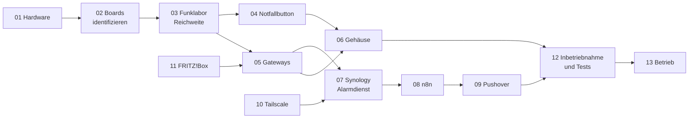

# 00 · Überblick, Voraussetzungen, Grenzen

> **Status: erste Fassung**  
> [← Inhaltsverzeichnis](README.md)

## Was am Ende steht

Eine allein arbeitende Person trägt einen kleinen Knopf bei sich. Drückt sie ihn mindestens 2 Sekunden lang, wird **still** Alarm ausgelöst: Vertrauenspersonen erhalten eine Pushover-Notfallmeldung, ohne Reaktion wird nach 180 Sekunden eine zweite Person alarmiert. Am Knopf selbst gibt es keinen Ton und kein Licht – nur Vibration, die anzeigt, ob der Alarm technisch angekommen ist und ob ein Mensch ihn quittiert hat.

  

## Grenzen – bitte zuerst lesen

> [!WARNING]
> NotfallbuttonLoRa ist ein **Selbstbau-Prototyp**. Es ist kein zertifiziertes Notruf- oder Überfallmeldesystem und ersetzt keine professionell betreute Anlage.

- Es wird **kein** Notruf an 110/112 abgesetzt.
- Funkreichweite und Verfügbarkeit sind **nicht garantiert**; sie müssen vor Ort gemessen werden.
- Fällt das Internet aus, funktionieren Pushover und Tailscale nicht. Ein LoRa-Paket am Gateway ist dann noch keine Alarmierung.
- Für ernsthafte Bedrohungslagen zuerst eine professionelle Lösung prüfen und einen schriftlichen Notfallplan festlegen.

## Bausteine

| Baustein | Aufgabe | wird … | Kapitel |
|---|---|---|---|
| Notfallbutton `SOS-01` | Taster, Funk, Vibration, Status-Display | programmiert | [04](04-notfallbutton-firmware.md), [06](06-gehaeuse-drucken.md) |
| Gateways `GW-PRAXIS`, `GW-HOME` | LoRa empfangen, ins lokale Netz weiterreichen | programmiert | [05](05-gateways.md) |
| Alarm-Eingangsdienst | Alarme annehmen, entdoppeln, protokollieren | programmiert | [07](07-synology-alarmdienst.md) |
| Synology-NAS | Container für Alarmdienst und n8n | eingerichtet | [07](07-synology-alarmdienst.md) |
| n8n | Ablaufsteuerung, Eskalation | eingerichtet | [08](08-n8n.md) |
| Pushover | Notfallmeldung und Quittierung | eingerichtet | [09](09-pushover.md) |
| Tailscale | private Verbindung Praxis ↔ Zuhause | eingerichtet | [10](10-tailscale.md) |
| FRITZ!Box | Netz für Gateways, optional Telefonanruf | eingerichtet | [11](11-fritzbox.md) |

## Reihenfolge

Die Funkmessung (Kapitel 03) kommt bewusst früh: Erst wenn feststeht, wo LoRa zuverlässig ankommt, lohnt sich der Aufbau der übrigen Kette.

## Voraussetzungen

### Hardware

- 4 × Heltec WiFi LoRa 32 mit passenden Antennen (EU-868-Variante – siehe [Kapitel 02](02-boards-identifizieren.md))
- Taster, neuer LiPo-Akku, optional Vibrationsmotor mit Treiberschaltung
- 3D-Drucker für die Gehäuse
- Details und Stückliste: [Kapitel 01](01-hardware-und-werkzeuge.md)

### Infrastruktur

- Internetanschluss mit FRITZ!Box an beiden Standorten
- Synology-NAS an beiden Standorten mit Container-Unterstützung
- Tailscale-Konto, auf beiden NAS eingerichtet
- Pushover-Konto und Pushover-App auf den Telefonen der Vertrauenspersonen

### Kenntnisse

- Arduino IDE bedienen und Boards flashen
- Grundlegende Bedienung von FRITZ!Box- und Synology-Oberfläche
- Löten einfacher Verbindungen (ab Kapitel 04)

## Schreibweisen in dieser Anleitung

| Schreibweise | Bedeutung |
|---|---|
| `<PRAXIS_NAS_IP>` | Platzhalter – durch den eigenen Wert ersetzen, **nicht** ins Repository eintragen |
| `OFFEN / ZU MESSEN` | Wert ist noch nicht belegt und muss gemessen oder geprüft werden |
| *Menü → Eintrag* | Pfad in einer Bedienoberfläche |

Zugangsdaten, Telefonnummern, IP-Adressen und Tailnet-Namen gehören in lokale `.env`-Dateien nach Vorlage – nie in Git. Screenshots in dieser Anleitung sind entsprechend geschwärzt.
